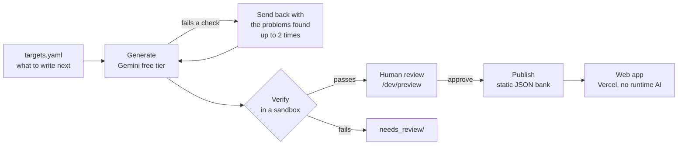

# Overcount

**Practice combinatorics and probability one decision at a time.**

**Live:** [overcount.vercel.app](https://overcount.vercel.app/)

Most counting mistakes aren't arithmetic. They're overcounting, undercounting, or picking the
wrong formula. Overcount lets you answer freely first; when you're stuck, it shows the answer's
structure as a one-line formula with empty boxes to fill in, explains *why* step by step, and
only then shows the worked solution. Answers are math expressions like `C(7,3)·C(5,2)`, graded
by exact value, so any equivalent form counts.

<!-- Demo GIF goes here (docs/demo.gif). -->

## How it works



- **Generate:** problem *families* (a root problem plus harder variants, each a template with
  variables and ranges) are drafted with the Gemini API free tier. A reply that fails any check
  is sent back with the problems found, up to twice.
- **Verify:** each family comes with a small Python checker that lists every candidate outcome
  and decides which ones count.
  - Counting those outcomes must equal the answer formula on many number sets.
  - Every example that "counts" / "doesn't count" must be a real outcome of that kind.
  - Every fill-in skeleton must add up to the answer.
  - Probability problems with unequal chances also get a Monte Carlo simulation.

  Formulas are parsed with a whitelisted grammar (never `eval`), and the checker runs in an
  isolated process with time and memory limits.
- **Publish:** approved families become concrete number sets, each with examples, outcome
  diagrams, Help steps and a worked small case, shipped as static JSON. The site makes no
  runtime AI calls and costs $0 to serve.

**Today's bank:** 6 verified families (6 problems + 9 variants), 528 problem instances, and
19 method lessons whose 40 formulas are checked by brute force. More families are on the way.

## Learning features

- **Examples and diagrams:** every problem shows one outcome that counts and one that doesn't,
  drawn as a small diagram (dice, cards, beads on a circle, stars and bars, …).
- **Fill in the blanks → Help → Show solution:** blanks for every number, then "why" steps one
  at a time, then the worked answer with this problem's numbers.
- **Practice by method:** 19 counting methods, each with a short lesson and its own problem
  list.
- **Roadmap home:** a map of topics and what builds on what, plus a daily problem.
- **Progress:** each try is saved in your browser. Tries show as dots, with a heatmap and a
  tries-per-day chart; a problem is *mastered* when solved within two tries.

## Roadmap

**v1, a live practice site**
- Done: playable problems with an answer-first flow, Help blanks and exact grading
- Done: a content pipeline (Gemini drafts → automatic verification → human review → publish)
- Done: practice by method, lessons, saved progress, roadmap home, diagrams, deploy
- In progress: more problems (target: about 50 root problems, at least 3 per topic)

**v2 and later**
- A tutor chat: "Ask about this step"
- Login, with progress synced across devices
- Solved-per-difficulty stats
- Weak spots, tutorials and "Fix my weak spots"
- Your own problems (private first)
- Machine learning to predict difficulty and recommend the next problem

## Stack

| Part | Tech |
|---|---|
| Pipeline | Python 3.12+, uv, Pydantic, SymPy, google-genai, pytest, mypy, ruff |
| Web | Vite, React, TypeScript, Tailwind, MathLive + Compute Engine, KaTeX, D3 |
| Hosting | Vercel (static), GitHub Actions CI |

## Run it locally

You need [uv](https://docs.astral.sh/uv/), Node 22+ and (optionally)
[pre-commit](https://pre-commit.com/).

**Web app** (uses the problem bank already in the repo):

```bash
cd web
npm install
npm run dev        # http://localhost:5173
npm test           # grades every published answer, skeleton and solution
```

**Pipeline:**

```bash
cd pipeline
uv sync
uv run overcount verify      # run every gate on the committed families
uv run overcount build       # rebuild web/public/bank/ from content/
uv run pytest -q
```

**Generating new problems** (optional, needs a free Gemini key):

```bash
pre-commit install          # gitleaks secret scan on every commit
cp .env.example .env        # then add GEMINI_API_KEY to .env
cd pipeline
uv run overcount generate --limit 1   # drafts one family into staging/
uv run overcount review              # verify drafts; preview at /dev/preview/<slug>
uv run overcount approve <slug>       # publish it and rebuild the bank
uv run overcount stats
```

## Security

- The only secret (`GEMINI_API_KEY`) lives in a gitignored `.env` and is read only by the
  Python pipeline. It is never exposed to the browser bundle, and the deployed site needs no
  keys.
- [gitleaks](https://github.com/gitleaks/gitleaks) runs as a pre-commit hook and in CI.
- Generated checkers run in a separate Python process with an import allowlist and time and
  memory limits.
